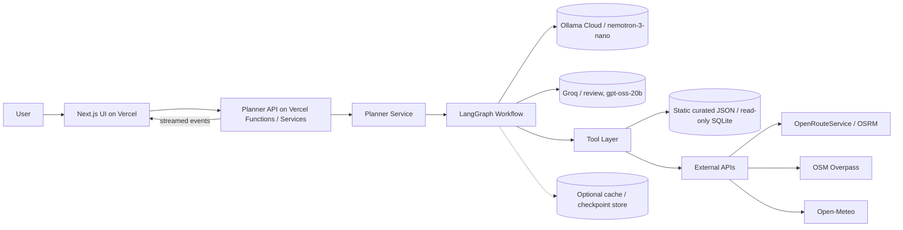
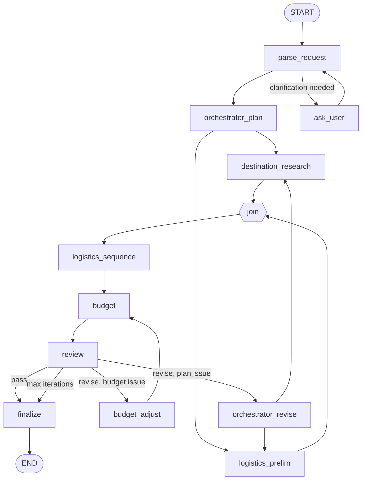

# Architecture — Dubai AI Travel Planner (LangGraph)

Companion to [problemStatement.md](./problemStatement.md). Data sourcing is in [research.md](./research.md). The committed catalog (counts, empty fields, and planner constraints) is locked in [implementationplan.md](./implementationplan.md) section 1.7. Product defaults are in [decisions.md](./decisions.md).

---

## 1. Goals and Design Principles

| Principle | What it means in practice |
| --- | --- |
| **LangGraph is the orchestrator** | One `StateGraph`. Agents are nodes. There is no second framework. |
| **Shared typed state** | All agents read and write one Pydantic-backed state object. No hidden side channels. |
| **LLMs reason, code calculates** | Prices, totals, distances, and constraint checks are deterministic Python. The LLM only interprets, selects, sequences, and explains. |
| **Offline-first data** | A curated local dataset always works. Free APIs enrich it and are never required. |
| **Free data, chosen LLMs** | Catalog and map sources stay free (see research.md). Non-review LLM calls use Ollama Cloud. Review uses Groq `openai/gpt-oss-20b`. |
| **Provenance on every fact** | Each item carries `verified`, `api`, or `estimated`. The UI shows it. |
| **Review can say no** | The review node can route back to earlier nodes. The loop is bounded. |
| **Observable** | Every node emits events (start, output summary, state diff) that the Vercel-hosted Next.js UI renders live. |
| **A pasted plan can be refused** | `/audit` matches a chatbot itinerary to the catalog and runs the same budget and review rules. Unknown names and failed checks are shown. The repair keeps only usable places. |

Non-goals: booking, live prices, flights, multi-city trips, user accounts.

---

## 2. System Context



### Layers

1. **Presentation**: Next.js / React app deployed on Vercel. Collects the request, shows live agent activity, renders the itinerary and budget. `/audit` is the non-technical path: paste a plan from another AI and read a verdict.
2. **API boundary**: Vercel-hosted HTTP endpoints expose planner runs, streamed events, exports, and optional resume actions. The browser never imports Python or LangGraph internals.
3. **Service**: A thin Python `PlannerService` that builds the graph, runs it, and yields events.
4. **Orchestration**: The LangGraph workflow (nodes, edges, routing functions, state).
5. **Agents**: Node functions. Each wraps a prompt, an LLM call (structured output), and a set of tools.
6. **Tools / Data access**: Typed functions with cache/API/local-fallback behavior. Return provenance-tagged results.
7. **Data and persistence**: Static curated data is bundled read-only. Runtime cache and durable checkpoints stay off unless `CACHE_STORE_URL` / `CHECKPOINT_STORE_URL` are set ([decisions.md](./decisions.md)). No Marketplace store is selected yet.

### Vercel deployment model

Preferred MVP deployment:

- One Vercel project using **Vercel Services**.
- `web`: Next.js App Router service for the UI.
- `planner-api`: Python FastAPI service running LangGraph and streaming Server-Sent Events.
- Vercel rewrites route browser calls from `/api/planner/*` to the planner service.
- Node.js remains the default runtime for the web service. The planner service uses the Vercel Python runtime or a Vercel container image only if Python dependency size or system dependencies require it.

Local-only Streamlit can still be useful for quick experiments, but it is not part of the Vercel deployment architecture.

### Itinerary auditor

`POST /api/planner/audits` does not enter the graph. `travel_planner.audit` matches the pasted text to catalog names, lays the matches out in that order, and calls `compute_budget` and `run_rules`. A repair keeps open places from the paste, calls `sequence_itinerary`, and may swap the stay for a cheaper catalog hotel. Names that do not match are findings. The auditor does not fill a failed paste with unrelated catalog places, and it does not call an LLM.

The page is `/audit`. Copy there is for someone who has a chatbot itinerary and wants to know whether it works. The dev dashboard under `/dev` is unchanged.

---

## 3. Workflow Graph



### Why this shape

- **Parallel fan-out** after the orchestrator: destination research (what to do) and preliminary logistics (where to stay, regional layout, transport options) do not depend on each other.
- **Join, then sequence**: once attractions are chosen, the logistics agent orders them geographically and computes real travel times. This is a second logistics pass, shown as a separate node so the UI can show it.
- **Two kinds of revision**:
  - *Budget issue* only: cheaper alternatives are swapped in (`budget_adjust`) and costs are recomputed. No need to redo research.
  - *Plan issue* (preferences, feasibility, duplicates, crowding): the orchestrator revises constraints and re-runs research and logistics.
- **Bounded loop**: `max_revisions` (default 3). On exhaustion the plan is finalized with warnings listed, not silently accepted.

### Node responsibilities

| Node | Type | Reads | Writes | Tools |
| --- | --- | --- | --- | --- |
| `parse_request` | LLM (structured output) | `raw_request` | `constraints`, `clarifications` | none |
| `orchestrator_plan` | LLM + rules | `constraints` | `plan_brief` (per-day themes, focus areas, search hints) | none |
| `destination_research` | LLM + tools | `constraints`, `plan_brief` | `candidates` (attractions, restaurants, areas) | `search_attractions`, `search_restaurants`, `get_weather` |
| `logistics_prelim` | LLM + tools | `constraints`, `plan_brief` | `stay_options`, `transport_options` | `search_hotels`, `get_transport_options` |
| `logistics_sequence` | Rules + tools (LLM for tie-breaks) | `candidates`, `stay_options` | `draft_itinerary` (days, slots, legs with durations) | `route_matrix`, `route_leg` |
| `budget` | Deterministic code (LLM only for explanations) | `draft_itinerary`, `constraints` | `budget_report` | `price_lookup`, `fare_calculator` |
| `budget_adjust` | LLM + rules | `budget_report`, `candidates` | updated `draft_itinerary` | `price_lookup` |
| `review` | Rules first, then Groq `openai/gpt-oss-20b` | everything | `review_report` | none |
| `orchestrator_revise` | LLM | `review_report`, `constraints` | updated `plan_brief`, `excluded_ids` | none |
| `finalize` | Rules + LLM (narration) | everything | `final_itinerary` | none |
| `ask_user` | Interrupt | `clarifications` | `raw_request` addendum | none |

`ask_user` uses LangGraph interrupts and is only entered when required fields are missing (for example, no trip length). Otherwise sensible defaults are applied and recorded as assumptions.

---

## 4. Shared State

```python
class TripState(TypedDict):
    # input
    raw_request: str
    constraints: Constraints | None
    assumptions: list[str]

    # planning
    plan_brief: PlanBrief | None
    candidates: Candidates | None
    stay_options: list[StayOption]
    transport_options: list[TransportOption]
    draft_itinerary: Itinerary | None

    # evaluation
    budget_report: BudgetReport | None
    review_report: ReviewReport | None

    # control
    revision_count: int
    excluded_ids: Annotated[list[str], operator.add]   # reducer: accumulate
    events: Annotated[list[AgentEvent], operator.add]  # reducer: append-only log
    warnings: Annotated[list[str], operator.add]

    # output
    final_itinerary: Itinerary | None
```

Notes:

- Parallel nodes write to different keys, so no conflicts. Keys written by several nodes use reducers (`operator.add`).
- `events` is the audit log that powers the UI timeline and the "how the plan changed" view.
- Checkpointing uses in-memory state only inside a single request. Durable resume is off unless `CHECKPOINT_STORE_URL` is set. Do not rely on local filesystem writes in deployed Vercel functions.

---

## 5. Data Models (Pydantic)

All LLM outputs use structured output bound to these schemas. Invalid output triggers one repair retry, then a fallback.

```python
Provenance = Literal["verified", "api", "estimated"]

class Sourced(BaseModel):
    provenance: Provenance
    source: str            # e.g. "curated:attractions.json", "openrouteservice", "rta_2025"
    as_of: date | None = None

class Constraints(BaseModel):
    days: int = Field(ge=1, le=7)
    budget_aed: float | None
    budget_scope: Literal["total", "per_person"] = "total"
    travelers: int = 1
    excludes: list[Literal["flights"]] = ["flights"]
    interests: list[str]                    # culture, food, beaches, ...
    hotel_tier: Literal["budget", "mid", "luxury"] | None
    avoid_crowds: bool = False
    pace: Literal["relaxed", "balanced", "packed"] = "balanced"
    start_date: date | None
    dietary: list[str] = []
    mobility: str | None

class Place(Sourced):
    id: str
    name: str
    category: str                           # museum | beach | mall | neighbourhood | ...
    area: str                               # one of PLANNING_AREAS
    lat: float; lng: float
    tags: list[str]                         # culture, beach, family, nightlife, landmark, ...
    price_aed: PriceRange | None
    crowd_level: Literal["low", "medium", "high"] | None
    typical_visit_minutes: int | None
    opening_hours: dict | None              # weekday keys or "daily"
    indoor: bool | None
    timed_entry: bool = False
    operational_status: Literal["open", "closed", "reopening"] = "open"
    status_as_of: date | None = None        # e.g. Museum of the Future reopening Sept 2026

class Leg(Sourced):
    from_id: str; to_id: str
    mode: Literal["walk", "metro", "bus", "taxi", "tram", "ferry", "drive"]
    minutes: int
    distance_km: float
    cost_aed: float | None

class Slot(BaseModel):
    start: time; end: time
    place_id: str | None
    kind: Literal["activity", "meal", "transfer", "rest", "checkin", "checkout"]
    notes: str | None

class DayPlan(BaseModel):
    day: int
    theme: str
    slots: list[Slot]
    legs: list[Leg]
    holiday_note: str | None = None

class BudgetLine(Sourced):
    category: Literal["accommodation", "food", "transport", "activities", "buffer"]
    item: str
    unit_aed: float
    quantity: float
    total_aed: float

class BudgetReport(BaseModel):
    lines: list[BudgetLine]
    by_category: dict[str, float]
    total_aed: float
    budget_aed: float | None
    variance_aed: float | None
    within_budget: bool
    alternatives: list[Alternative]         # concrete swaps with savings

class Violation(BaseModel):
    rule: str
    severity: Literal["blocker", "warning"]
    detail: str
    route_to: Literal["budget_adjust", "orchestrator_revise", "none"]

class ReviewReport(BaseModel):
    passed: bool
    violations: list[Violation]
    scores: dict[str, float]                # budget, feasibility, preference, ...
```

The final output (`Itinerary`) contains: `days`, `stay`, `budget`, `provenance_summary`, `assumptions`, `warnings`, and `revision_history`.

Catalog entities live beside these trip types (`Restaurant`, `Hotel`, `StayOption`, `TransitStation`, `TransitEdge`, `Fare`, `PriceBand`, `ClimateMonth`, `Holiday`). Planning areas are `Old Dubai`, `Downtown`, `Marina / JBR`, `Jumeirah`, `Al Quoz`, `Palm`, `Dubai Creek`, and `Business Bay`. Restaurants are not `Place` rows. Hotels expose `Hotel.stay_option("peak" | "summer")`. `TransitStation.zone` exists on the schema but is empty in the seed, so fares use a planner-side area-to-zone map. Holiday effects are category rules (`drop_lunch`, `heritage_may_close_first_day`, `high_crowd`), not a per-place closure list.

---

## 6. Agents in Detail

### 6.1 Orchestrator

Two roles in the graph, both thin:

- `parse_request`: extracts `Constraints` from free text. Applies defaults (balanced pace, total budget, 1 traveler) and records each as an assumption. Flags missing critical fields.
- `orchestrator_plan` / `orchestrator_revise`: converts constraints into a `plan_brief` (per-day themes, e.g. "Day 1 Old Dubai culture", target areas from `PLANNING_AREAS`, crowd-avoidance hints). `cuisine_focus` may stay empty: every restaurant `cuisine` is `unspecified`. Do not put heritage on Eid day one, or mall/beach days on National Day, when `avoid_crowds`. On revision it reads `ReviewReport` and adjusts: exclude IDs, change themes, shift pace, widen a thin area to a Metro neighbour.

The "orchestrator" is the graph's routing plus these nodes. Routing logic itself is plain Python in conditional edge functions, so control flow is predictable and testable.

### 6.2 Destination Research

- Queries curated data first, then optional APIs, then merges and de-duplicates by name and coordinates.
- Scores places against interest **tags** (`culture`, `beach`, `family`, `nightlife`, `landmark`), `crowd_level`, `indoor` vs climate heat, `operational_status == open`, and `excluded_ids`. Never select `closed` or `reopening` (Museum of the Future is the fixture).
- Restaurants match on area, `price_band`, and remaining `meal_types` (lunch and dinner in the seed; lunch is dropped on Ramadan). Do not filter by `cuisine`.
- Thin areas (Business Bay, Al Quoz, Dubai Creek) relax to a neighbouring area on the same Metro line before an interest is dropped.
- Holiday filters from `rules/holidays.py` (`places_for_day`, `restaurants_for_day`) run before scoring when `start_date` is set.
- The LLM picks and explains from a **shortlist** (top N by deterministic score) rather than free-generating places. This prevents invented venues.
- Output: ranked attractions, restaurants, beach options, and candidate areas.

### 6.3 Logistics

Two passes:

1. **Prelim** (parallel with research): proposes hotel areas that fit the tier and likely geography (for example Old Dubai for budget plus culture, preferring rows with `metro_nearby`). Do not use `stars` (empty in the seed). Transport options are Silver Metro/tram, taxi, and Abra. There is no bus fare table.
2. **Sequence** (after research): clusters selected places by area and day, merging thin areas with a Metro neighbour so no day is empty. Orders them to minimize travel. Offline durations come from Dijkstra on the curated transit graph (Red, Green, Tram, plus two 6-minute tram–metro walks at JLT/DMCC and Marina/Sobha Realty), then straight line. Live ORS/OSRM can replace that in Phase 5. Inserts transfer slots and assigns time windows from `typical_visit_minutes`, opening hours (`mon`…`sun` or `daily`), remaining meal types, and heat (if that month's climate `avg_high_c >= 35`, outdoor items are not scheduled 12:00–16:00). Applies holiday notes with `apply_day_notes`.

Clustering and ordering use a deterministic heuristic (greedy by area, then nearest-neighbour with a 2-opt improvement). The LLM only handles tie-breaks and day themes.

### 6.4 Budget

Fully deterministic calculation over the draft itinerary:

- Accommodation: `hotel.stay_option(season)` midpoint × nights. Season is `summer` for May–September, otherwise `peak`. Copy the hotel row's provenance (today: `estimated`).
- Food: one line per remaining restaurant `meal_types`, priced from `price_bands` for that `price_band`. There are no menu prices and no breakfast rows. Ramadan days already have lunch removed; do not invent it.
- Transport: sum of leg costs; compares pay-per-trip Silver fares against the estimated 1-day pass and the Silver 7-day pass for the trip's zone span. RTA publishes no automatic daily cap on Silver cards, so no cap is assumed. Station zones are not in the seed; zone span comes from the planner-side area map.
- Activities: `place.price_aed.max_aed` × travelers, including AED 0 free entries so provenance stays visible.
- Buffer: configurable contingency (default 10%) shown as its own line.

If total exceeds budget, the agent builds **alternatives with quantified savings** from real catalog IDs: cheaper hotel in the same area, paid place to a free or cheap equivalent, taxi leg to Metro/tram, dinner to a lower `price_band` in the same area. Each alternative reports the new total. If the request is below the hotel floor (cheapest budget night × nights, plus food bands and buffer), report that floor instead of a silent zero plan.

### 6.5 Review

Runs in two stages.

**Stage 1 — rule-based checks (authoritative):**

| Check | Rule | Routes to |
| --- | --- | --- |
| Budget compliance | `total_aed <= budget_aed` | `budget_adjust` |
| Day length | Active time per day within pace limits | `orchestrator_revise` |
| Travel feasibility | No leg exceeds a threshold; transfers fit between slots | `orchestrator_revise` |
| Opening hours | Each slot falls inside opening hours. Holiday effects from `rules/holidays.py`: Ramadan drops lunch; Eid day one holds museums, mosques, and galleries; Eid and National Day raise crowds on mall / beach / park / viewpoint / landmark / theme and water parks | `orchestrator_revise` |
| Operational status | No place with `operational_status` of `closed` or `reopening` appears in the plan (Museum of the Future is `reopening`) | `orchestrator_revise` |
| Duplicates | No place or near-identical category repeated beyond limit | `orchestrator_revise` |
| Completeness | Every day has lodging, transport, costs, and meals except lunch on `drop_lunch` days | `orchestrator_revise` |
| Crowds | If `avoid_crowds`, high-crowd places and holiday crowd categories are excluded or moved off that day | `orchestrator_revise` |
| Provenance | No unlabeled cost lines | `orchestrator_revise` |
| Interest coverage | Each stated interest appears at least once | `orchestrator_revise` |

**Stage 2 — LLM qualitative review:** coherence, pacing, and whether the plan "feels right" for the stated preferences. The LLM may add warnings or request revision but cannot overturn a rule-based blocker.

Routing precedence: if any blocker routes to `orchestrator_revise`, that wins over `budget_adjust` (a plan change will change costs anyway).

---

## 7. Routing Logic

```python
def route_after_review(state) -> str:
    r = state["review_report"]
    if r.passed:
        return "finalize"
    if state["revision_count"] >= MAX_REVISIONS:
        return "finalize"          # finalize with warnings attached
    blockers = [v for v in r.violations if v.severity == "blocker"]
    if any(v.route_to == "orchestrator_revise" for v in blockers):
        return "orchestrator_revise"
    return "budget_adjust"
```

- `revision_count` increments inside the revise nodes.
- Each loop appends an `AgentEvent` with the violations found and the change made, which produces the "how the plan changed during review" view.
- A built-in **demo scenario** uses catalog facts: a budget below the hotel floor, injecting `place-museum-of-the-future`, or pinning `start_date` to Eid (2026-03-19) or National Day (2026-12-02) with `avoid_crowds`. This satisfies the success criterion "detect and revise at least one violation".

---

## 8. Tool Layer and Data Access

### 8.1 Pattern

Every tool follows the same contract:

```python
class ToolResult(BaseModel, Generic[T]):
    data: T
    provenance: Provenance
    source: str
    degraded: bool = False     # true if fallback was used
    error: str | None = None
```

Resolution order per tool: **cache (only if `CACHE_STORE_URL` is set) → live API (if `USE_LIVE_APIS` and the circuit breaker is healthy) → curated dataset**. A circuit breaker disables an API for the session after repeated failures. Fallbacks set `degraded=True`, and the UI surfaces it. MVP runs skip cache and go local unless a store URL is configured.

### 8.2 Tools

| Tool | Primary | Fallback |
| --- | --- | --- |
| `search_attractions` | Local `PlaceRepo`. Almost every price is `estimated`. Filter `operational_status`, area, and tags | n/a (always local) |
| `search_restaurants` | Local `RestaurantRepo` by area, `price_band`, `meal_types` | n/a. Overpass may enrich cuisine/hours later; it does not replace curated rows |
| `search_hotels` | Local `HotelRepo` by area and tier. Nightly ranges are estimated tier bands. No live hotel API | n/a (always local) |
| `route_matrix` / `route_leg` | OpenRouteService (free key, optional) | OSRM public demo → 64-station / 65-edge Metro/tram/walk graph → straight line |
| `get_transport_options` | Curated RTA fare table (`fares.json`) plus graph minutes | n/a. Not an RTA GTFS feed |
| `fare_calculator` | Silver / Gold / Red / pass / taxi / Abra rows. Zone span from the planner-side area map, not `station.zone` | n/a |
| `price_lookup` | `price_bands.json` for food and unnamed extras; `place.price_aed` for tickets | food/activity band for that tier |
| `get_weather` | Open-Meteo forecast when live APIs are on | `climate.json` (Open-Meteo archive 2016–2025, climatology not a forecast) |
| holiday lookup | Local `HolidayRepo.overlapping` | n/a. Effects are category rules, not per-place closures |

### 8.3 Adapters

```
src/travel_planner/data/
  repository.py        # interfaces (Protocols)
  local/               # JSON/SQLite implementations
  providers/
    openrouteservice.py
    osrm.py
    overpass.py
    open_meteo.py
  cache.py             # pluggable cache: local for dev, external store in Vercel
  resilience.py        # retries, timeouts, circuit breaker, rate limiting
```

Agents depend on repository interfaces, never on a specific provider. Swapping providers or running fully offline needs no agent changes.

### 8.4 Caching and rate-limit control

All external sources are free but rate-limited, so the tool layer protects the free limits. Runtime cache is off unless `CACHE_STORE_URL` is set; the TTL rules below apply only when a store is configured.

- Cache key: hash of normalized request parameters.
- TTLs: places 30 days, routes 7 days (by time bucket), weather 3 hours, prices follow dataset version.
- OpenRouteService: a rate limiter keeps calls under 40 per minute, and a daily counter stays under the Standard limits (Matrix 500, Directions 2,000). Past the limit, routing falls back to OSRM and then to the curated graph.
- Overpass: every query sets an explicit `[timeout:...]` and `[maxsize:...]`, results are cached, and HTTP 429 / 504 trigger the curated fallback.
- Open-Meteo: forecast requests stay under the free limits (10,000 per day) and use the 3-hour cache.
- A per-run API call budget is configurable. The tool layer stops live calls once it is exceeded and falls back to local data.
- LLM calls are counted per run so the UI can show usage against the free-tier rate limits.

---

## 9. Local Dataset Design

SQLite (preferred for querying) with JSON seed files kept in version control for review.

| Table | Key fields |
| --- | --- |
| `places` | id, name, category, area, lat, lng, tags, crowd_level, visit_minutes, indoor, hours, price_min, price_max, timed_entry, operational_status, status_as_of, source, as_of |
| `restaurants` | id, name, cuisine, area, lat, lng, price_band, meal_types, hours, source, as_of |
| `hotels` | id, name, area, tier, peak_nightly_min/max, summer_nightly_min/max, lat, lng, metro_nearby, source, as_of |
| `transit_stations` | id, name, line, lat, lng, zone (unused in the seed) |
| `transit_edges` | from_id, to_id, line, minutes |
| `fares` | mode, zone_rule, price_aed, card_type, source, as_of |
| `price_bands` | category, tier, min_aed, max_aed, source |
| `climate` | month, avg_high, avg_low, rain_mm, humidity |
| `holidays` | id, name, kind, start, end, effects, notes, source, as_of |

Committed Phase 1 catalog (do not re-curate inside later phases; treat gaps as planner constraints):

| File | Count | Constraint |
| --- | --- | --- |
| `places.json` | 81 | Interest floors met. Museum of the Future is `reopening`. Business Bay has 3 places, Al Quoz and Dubai Creek 5. Almost all rows `estimated`. |
| `restaurants.json` | 80 | 10 per area, lunch + dinner, `cuisine` is `unspecified`, no menu prices. |
| `hotels.json` | 32 | Every area has budget / mid / luxury. Nightly ranges are estimated tier bands. `stars` is empty. |
| `transit_stations.json` | 64 | Red, Green, Tram. Union and Burjuman are `Red,Green`. `zone` is empty. |
| `transit_edges.json` | 65 | Estimated hop minutes, plus two tram–metro walks. Not GTFS. |
| `fares.json` | 20 | Verified Silver 1/2/3+ = 3/5/7.50. 1-day pass, taxi, and Abra are `estimated`. No bus table. |
| `price_bands.json` | 10 | Food and activity bands, all `estimated`. |
| `climate.json` | 12 | Open-Meteo archive 2016–2025. July mean high 41 °C. |
| `holidays.json` | 14 | 2026–2027 city-wide rows. Islamic dates stay `estimated` until a FAHR circular. |

Curation sources were free, but several intended fields were not filled. Later phases must not assume they were:

| Fact | What the seed actually has |
| --- | --- |
| Place identity and coordinates | Named list plus Nominatim (and some Wikidata/Overpass during curation) |
| Ticket price, timed entry, hours | Present on every place; almost all `estimated`, not official-site quotes |
| Restaurant cuisine | `unspecified` on every row |
| Hotel stars | Empty |
| Hotel nightly range | Shared tier bands from research.md, not each hotel's website |
| Fares | RTA Silver/Gold/Red and 7-day figures as recorded in research.md; taxi/Abra/1-day pass estimated |
| Station minutes | Scaled from Wikipedia line tables, not an RTA GTFS feed |
| Station Nol zone | Empty; fare zone span is a planner-side map |

Wikidata and Nominatim run only during curation. Runtime enrichment stays OpenRouteService, Overpass, and Open-Meteo, each with the curated row as fallback. Overpass must not overwrite prices, `operational_status`, or hotel nightly ranges. Each row has `source` and `as_of` so provenance is real, not decorative. Full inventory notes are in implementation plan section 1.7.

---

## 10. LLM Integration

- **Provider abstraction**: a small factory in `llm.py` using LangChain chat models. Routing is by node, not a single global model: **`review` uses Groq** (`openai/gpt-oss-20b`); every other LLM node uses **Ollama Cloud** (`nemotron-3-nano`). `LLM_PROVIDER=groq` also sends the non-review nodes to Groq. Other providers can be plugged in through the same interface.
- **Structured output** for every agent call, validated by Pydantic.
- **Prompt files** live in `prompts/` as versioned templates, not inline strings.
- **Grounding rules** in every prompt: use only IDs from provided candidates; do not state prices not in context; do not invent cuisines or reopen `closed` / `reopening` places; surface uncertainty (`estimated` is the common case).
- **Determinism**: temperature 0 to 0.2 for extraction, review, and budget narration. Slightly higher for itinerary theming.
- **Rate limits and latency**: parallel nodes run concurrently, with retry and backoff on free-tier rate limits. Research and logistics prompts are short because tool output is pre-filtered by deterministic scoring.
- **Usage logging** (calls and tokens per node) feeds the UI so the demo stays inside the free limits.
- **Privacy**: requests must not contain personal data. Review goes to Groq. The other nodes go to Ollama Cloud.
- **Local-model caveat**: small local models are less reliable at structured output, so schemas stay simple and validation errors trigger a repair retry.

---

## 11. Frontend and API (Vercel)

### Next.js UI

1. **Input panel**: free-text request, optional structured overrides (days, budget, interests, start date, hotel tier, avoid crowds), toggles (use live APIs, demo "force revision" presets tied to catalog facts).
2. **Live agent timeline**: driven by streamed `AgentEvent` objects from the planner API. Each node shows status (running, done), duration, and a collapsible summary of what it produced.
3. **Graph view**: Mermaid render of the compiled graph (`graph.get_graph().draw_mermaid()`) with the active node highlighted.
4. **State inspector**: key slices of `TripState` as they change (constraints, candidates, draft, budget).
5. **Revision diff**: before/after of itinerary and budget for each review loop, with violations listed.
6. **Result tabs**: Itinerary (day cards with timings, legs, and `holiday_note`), Budget (category chart and line items with provenance badges; most catalog lines are ≈ estimated), Map (optional / post-MVP, using stored coordinates), Assumptions and warnings.
7. **Export**: JSON and Markdown download of the final itinerary.

Provenance badges: ✅ verified, 🌐 API-derived, ≈ estimated.

### Planner API

The browser calls a Vercel-hosted planner API rather than running LangGraph in the frontend.

| Endpoint | Purpose |
| --- | --- |
| `POST /api/planner/runs` | Start a planner run and stream `AgentEvent` updates as Server-Sent Events |
| `POST /api/planner/runs/{run_id}/resume` | Resume after an `ask_user` clarification, when durable checkpoints are enabled |
| `GET /api/planner/runs/{run_id}/result` | Return the final itinerary JSON for a completed run |
| `GET /api/planner/runs/{run_id}/export.md` | Return a Markdown export |

For the MVP, a single streaming `POST` can be enough if clarification and resume are handled in the same browser session. Durable resume requires an external checkpointer.

Streaming approach: `PlannerService.run(request)` is a Python generator yielding `AgentEvent` objects. The API converts those events to SSE chunks, and the Next.js UI updates React state as chunks arrive. The UI never imports LangGraph types directly.

```python
class AgentEvent(BaseModel):
    ts: datetime
    node: str
    phase: Literal["start", "end", "error", "revision"]
    summary: str
    state_delta: dict
    duration_ms: int | None
    tokens: dict | None
```

---

## 12. Error Handling and Resilience

| Failure | Behavior |
| --- | --- |
| LLM output fails schema | One repair retry with the validation error, then deterministic fallback for that node |
| API timeout / quota / auth | Retry with backoff, circuit breaker, fall back to local data, mark `degraded` |
| No candidates match | Relax lowest-priority constraints, record an assumption, continue |
| Budget impossible (below hotel floor) | Report minimum feasible budget, return best-effort plan with a clear warning |
| Revision loop exhausted | Finalize with remaining violations listed as warnings |
| Missing critical input | `ask_user` interrupt, or documented defaults |
| Prompt injection via place text | Place descriptions are treated as data, passed in delimited fields, and never allowed to alter instructions or tool use |

Graph-level: per-node timeouts and a recursion limit set on the compiled graph as a hard stop.

---

## 13. Configuration and Security

- Local `.env` / `.env.local` for development and Vercel project environment variables for deployment: `LLM_PROVIDER`, `OLLAMA_API_KEY`, `OLLAMA_MODEL`, `OLLAMA_BASE_URL`, `GROQ_API_KEY`, `GROQ_MODEL`, `GEMINI_API_KEY`, `GEMINI_MODEL`, `ORS_API_KEY`, `USE_LIVE_APIS`, cache/checkpoint store URLs, and any storage tokens.
- Settings loaded via `pydantic-settings`. Missing keys disable the related provider rather than failing.
- Keep keys out of version control (`.env` in `.gitignore`, `.env.example` with placeholders only).
- Never log keys or full prompts containing user data at default log level.
- Respect provider terms: attribute OSM (ODbL) and Open-Meteo (CC BY 4.0) where their data is shown. Wikidata is CC0. Follow the Nominatim, Overpass, and Wikidata Query Service usage policies. Use Wikidata and Nominatim only while curating. Use the free Open-Meteo API for non-commercial purposes only.
- The deployed app uses Ollama Cloud (`https://ollama.com`, model `nemotron-3-nano`) for every LLM node except `review`, which uses Groq (`openai/gpt-oss-20b`). `LLM_PROVIDER=groq` also sends the non-review nodes to Groq. A localhost Ollama base URL is for local development only.
- Do not write runtime cache, generated SQLite files, checkpoints, or exports to the deployed filesystem. Vercel functions are stateless and may scale to zero. Cache and durable checkpoints stay off unless store URLs are set.

---

## 14. Testing and Evaluation

| Level | What | How |
| --- | --- | --- |
| Unit | Budget math, fare calculator, route ordering, each review rule | pytest, no LLM |
| Contract | Pydantic schemas, tool result shapes | pytest + fixtures |
| Provider | Each adapter against recorded responses | VCR-style cassettes |
| Node | Each agent with a stubbed LLM returning fixed structured output | pytest |
| Graph | Full run with fake LLM: pass path, budget-revise path, plan-revise path, max-iteration path | pytest |
| Offline | Entire flow with all APIs disabled | pytest marker `offline` |
| Evaluation set | 8 to 10 sample requests (varying days, budget, preferences, start date) scored on budget compliance, schedule feasibility, interest coverage, duplicate rate, closed-place rate, holiday-rule adherence | script, tracked over time |
| Success criteria | Maps to problem statement section 9 | Checklist test: one scenario must trigger and resolve a violation |

LangSmith tracing is optional for debugging.

---

## 15. Project Structure

```
Multi Agent Travel Planner/
├─ docs/
│  ├─ problemStatement.md
│  ├─ architecture.md
│  └─ research.md
├─ apps/
│  └─ web/                    # Next.js app deployed on Vercel
│     ├─ app/                 # App Router pages and API-facing UI code
│     ├─ components/
│     └─ lib/
├─ services/
│  └─ planner-api/            # Python API service deployed on Vercel
│     ├─ api/                 # FastAPI routes / streaming endpoints
│     └─ src/travel_planner/
├─ data/
│  ├─ seed/                  # JSON seed files (reviewable)
│  └─ dubai.sqlite           # built from seed; read-only in deployment if bundled
├─ prompts/                  # versioned prompt templates
├─ src/travel_planner/        # optional shared package during early development
│  ├─ config.py
│  ├─ models/                # Pydantic schemas
│  ├─ state.py               # TripState and reducers
│  ├─ graph/
│  │  ├─ build.py            # StateGraph assembly
│  │  ├─ routing.py          # conditional edge functions
│  │  └─ nodes/              # one file per agent node
│  ├─ tools/                 # agent-facing tools over the data layer
│  ├─ data/                  # repositories, providers, cache, resilience
│  ├─ rules/                 # review rules, budget calculators, clustering
│  ├─ llm.py                 # provider factory
│  └─ service.py             # PlannerService (event streaming)
├─ scripts/
│  ├─ build_db.py
│  └─ run_eval.py
├─ tests/
├─ vercel.json or vercel.ts   # Vercel services, rewrites, and function config
├─ pyproject.toml
├─ package.json
└─ .env.example
```

During early implementation, the Python package can live at the repo root. Before deployment, either package it into `services/planner-api` or configure the Vercel service root so imports and data files are included correctly.

---

## 16. Implementation Phases

| Phase | Deliverable | Exit check |
| --- | --- | --- |
| 1. Foundations | Project skeleton, config, Pydantic models, seed dataset, SQLite build | Done. Catalog locked in implementation plan 1.7 |
| 2. Deterministic core | Budget calculator, fare logic, route ordering, review rules | Unit tests pass with no LLM |
| 3. Graph skeleton | LangGraph with stubbed LLM nodes, routing, reducers, loop | All four graph paths tested |
| 4. LLM agents | Real prompts and structured output for all nodes | Sample requests produce valid itineraries offline |
| 5. Live data | OpenRouteService, Overpass, Open-Meteo adapters with cache, rate limiting, and fallback | Same request works with APIs on and off |
| 6. Vercel UI and API | Next.js UI, streaming planner API, graph view, state inspector, revision diff, exports | Live Vercel preview run is watchable end to end |
| 7. Hardening and deployment | Evaluation set, error handling, demo scenarios, docs, Vercel env and preview/prod checks | Success criteria checklist all green on local and Vercel preview |

---

## 17. Key Decisions and Trade-offs

| Decision | Rationale | Trade-off |
| --- | --- | --- |
| Deterministic budget and review rules | Trustworthy numbers, testable, cheap | Less flexible than free-form LLM judgement. Mitigated by the LLM qualitative second stage. |
| LLM picks from shortlists | Prevents hallucinated venues | Quality depends on retrieval and scoring |
| Curated local DB as source of truth | Reliable demos, offline mode | Needs manual upkeep. `as_of` dates make staleness visible. Most prices are already `estimated`. |
| Empty station zones and restaurant cuisine | Still ship a fare and meal plan | Planner-side area-to-zone map; restaurants match on area, band, and meal types |
| Thin planning areas | Coverage floors still met city-wide | Sequence merges Business Bay / Al Quoz / Creek with a Metro neighbour |
| Two-pass logistics | Real travel times need chosen places | One extra node and call |
| Two review routes | Avoids redoing research for pure budget issues | More routing logic to test |
| Bounded revision loop | Predictable cost and latency | May finalize with warnings |
| Repository interfaces over direct API calls | Swappable and testable providers | Some extra boilerplate |
| Vercel-native web app over Streamlit | Deployable previews, production URL, web-native streaming UI | Requires a React/Next.js UI instead of Streamlit's quick widgets |
| External runtime persistence | Works with stateless Vercel functions and scale-to-zero | More setup than local SQLite/diskcache |

---

## 18. Open Questions

Product defaults from this list are locked in [decisions.md](./decisions.md): budget is total for the group, accommodation is inside the budget, map view is post-MVP, durable resume and runtime cache stay off unless store URLs are set, `review` uses Groq `openai/gpt-oss-20b`, and all other LLM nodes use Ollama Cloud (`nemotron-3-nano`).

Still open:

- Which external store, if any, holds cache and checkpoints.
- Whether the planner API needs a container image if the dependency size forces it.

---

## 19. Catalog deviations the planner assumes

These are the facts the running planner uses. They replace earlier assumptions in the data model wherever the two disagree. The locked counts and gaps are in [implementationplan.md](./implementationplan.md) section 1.7.

- `TransitStation.zone` is empty on every station. Fare zone span comes from the planner-side area map in `rules/fares.py` and is `estimated`.
- Restaurant `cuisine` is `unspecified` on every row. Meals match planning area, `price_band`, and `meal_types`.
- Hotel `stars` is empty. Each hotel has its own estimated peak and summer nightly range via `Hotel.stay_option`. There is no single shared tier price and no hotel-site quote.
- Most catalog prices are `estimated`. Dubai Frame's adult ticket is the only `verified` place price. Silver Nol fares for 1, 2, and 3+ zones are `verified`. The 1-day pass stays `estimated`.
- There is no RTA GTFS feed in the seed. Offline routing is the 64-station, 65-edge Metro and tram graph, then a straight-line estimate.
- Business Bay, Al Quoz, and Dubai Creek are thin. A day in one of them is themed with its Metro neighbour. Hotels and restaurants still exist in those eight planning areas.
- Satellite areas (Dubailand, Al Barsha, and the others in section 1.7) have places but no hotel or restaurant row. The stay and meals stay in a planning area.
- Museum of the Future is `reopening`. A draft that still contains it is a blocker.

Evaluation thresholds live in `scripts/run_eval.py`: budget compliance or an explicit hotel-floor flag, a feasible schedule, holiday-rule adherence, provenance on every cost line, a closed-place rate of 0, and a duplicate rate of 0. Default logs omit API keys and the raw request. LangSmith tracing is off unless `LANGSMITH_TRACING` is set, and node traces still record only the request length.
