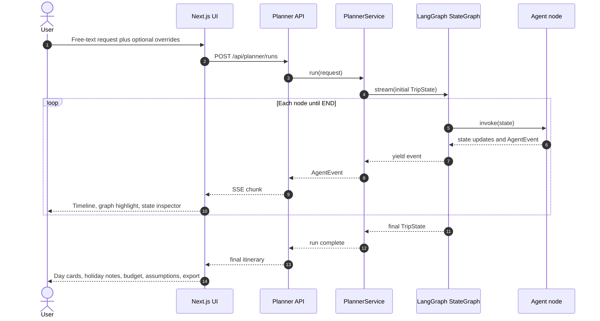
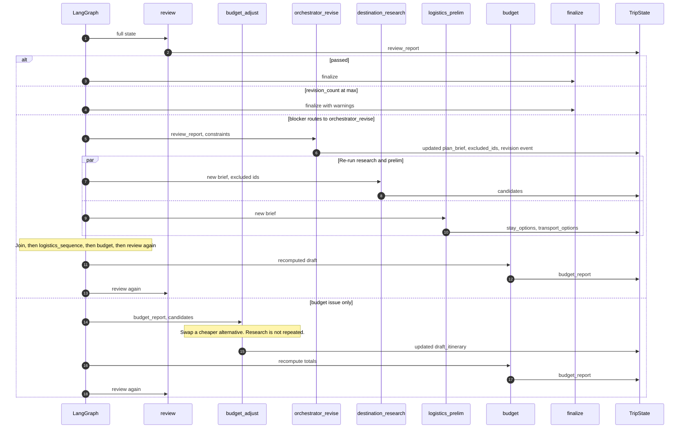
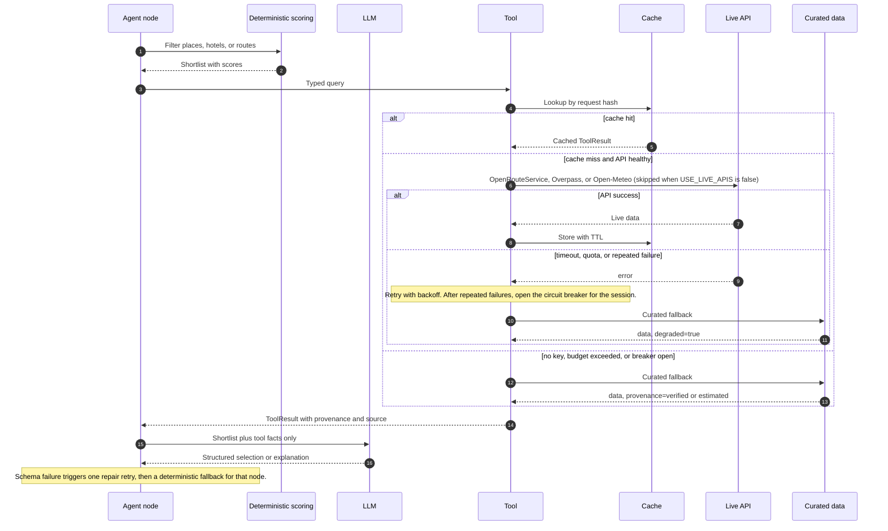
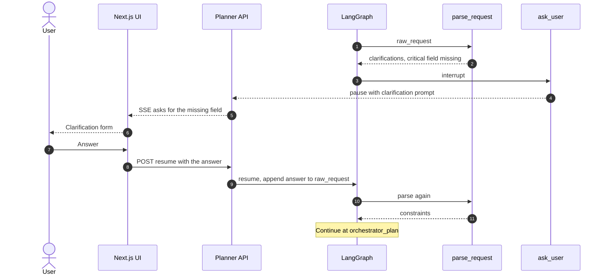
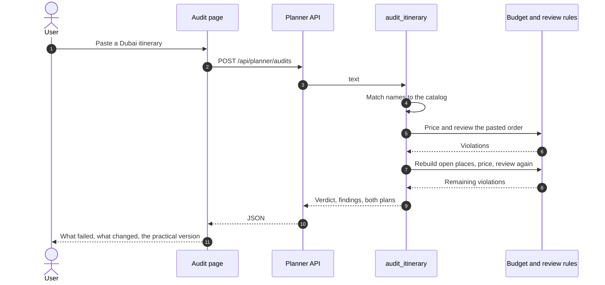

# Sequence Diagrams — How the Multi-Agent Planner Runs

Companion to [architecture.md](./architecture.md). Product defaults are in [decisions.md](./decisions.md). The catalog the tools read is locked in [implementationplan.md](./implementationplan.md) section 1.7.

These diagrams show who calls whom at runtime: the UI, the planner API, LangGraph, each agent node, the LLM, and the tool layer.

Agents are nodes on one `StateGraph`. They do not call each other directly. LangGraph invokes a node, the node reads and writes shared `TripState`, and a routing function chooses the next node. Every node appends an `AgentEvent` (`start`, `end`, `error`, or `revision`) that the API streams to the UI.

---

## 1. Starting a run

The browser never imports LangGraph. It posts a request, then consumes Server-Sent Events while nodes execute.



`PlannerService.run` is a generator. It does not expose LangGraph types to the API or the UI. A later `GET /api/planner/runs/{run_id}/result` or Markdown export reads the finished itinerary.

---

## 2. Happy path — review passes

This is the default collaboration. After the orchestrator writes a plan brief, destination research and preliminary logistics run in parallel, then join. Sequencing, budget, and review run in order. If review passes, finalize writes the itinerary.

```mermaid
sequenceDiagram
    autonumber
    participant G as LangGraph
    participant Parse as parse_request
    participant Orch as orchestrator_plan
    participant Research as destination_research
    participant Prelim as logistics_prelim
    participant Seq as logistics_sequence
    participant Budget as budget
    participant Review as review
    participant Final as finalize
    participant LLM as LLM
    participant Tools as Tool layer
    participant State as TripState

    G->>Parse: raw_request
    Parse->>LLM: Extract Constraints
    LLM-->>Parse: Constraints
    Parse->>State: constraints, assumptions, clarifications
    Note over Parse,G: If a critical field is missing, route to ask_user instead. See section 5.

    G->>Orch: constraints
    Orch->>LLM: Build per-day themes and search hints
    LLM-->>Orch: PlanBrief
    Orch->>State: plan_brief

    par Research and prelim logistics
        G->>Research: constraints, plan_brief
        Research->>Tools: search_attractions, search_restaurants, get_weather, holidays
        Tools-->>Research: Provenance-tagged shortlist (open places only; restaurants by area and price band, not cuisine)
        Research->>LLM: Pick and explain from shortlist only
        LLM-->>Research: Selected places
        Research->>State: candidates
    and
        G->>Prelim: constraints, plan_brief
        Prelim->>Tools: search_hotels, get_transport_options
        Tools-->>Prelim: Stay and transport options (tier and metro_nearby; stars are empty)
        Prelim->>LLM: Propose hotel area and fare class
        LLM-->>Prelim: Stay and transport choice
        Prelim->>State: stay_options, transport_options
    end

    Note over G: Join. Sequencing waits until both writes land. They write different state keys, so there is no conflict.

    G->>Seq: candidates, stay_options
    Seq->>Tools: route_matrix, route_leg, holidays, climate
    Tools-->>Seq: Durations, holiday effects, monthly heat
    Note over Seq: Code clusters by area (thin areas merge with a neighbour), Dijkstra on the 64-station graph then straight line, heat rest if avg_high_c >= 35, holiday_note on each day. The LLM only breaks ties and names day themes. Live ORS is skipped unless USE_LIVE_APIS and a key are set.
    Seq->>State: draft_itinerary

    G->>Budget: draft_itinerary, constraints
    Budget->>Tools: price_lookup, fare_calculator
    Tools-->>Budget: Prices and fares
    Note over Budget: Accommodation uses stay_option peak/summer. Food uses price bands (no menu prices). Fares use the planner-side zone map. The LLM only narrates.
    Budget->>State: budget_report

    G->>Review: full state
    Note over Review: Stage 1 is rule checks. Stage 2 is an LLM qualitative review that cannot overturn a rule blocker.
    Review->>State: review_report passed
    G->>Final: full state
    Final->>LLM: Narrate the plan
    LLM-->>Final: Narrative
    Final->>State: final_itinerary
```

### What each node writes

| Node | Calls | Writes to TripState |
| --- | --- | --- |
| `parse_request` | LLM structured output | `constraints`, `assumptions`, `clarifications` |
| `orchestrator_plan` | LLM | `plan_brief` |
| `destination_research` | Tools, then LLM over a scored shortlist | `candidates` |
| `logistics_prelim` | Tools, then LLM | `stay_options`, `transport_options` |
| `logistics_sequence` | Tools; LLM only for tie-breaks | `draft_itinerary` |
| `budget` | Tools; totals are deterministic | `budget_report` |
| `review` | Rules, then LLM | `review_report` |
| `finalize` | LLM for narration | `final_itinerary` |

---

## 3. Review decides the next agent

`route_after_review` is plain Python, not an LLM call. A plan-level blocker wins over a budget-only issue, because changing the plan changes the costs. `revision_count` increments inside the revise nodes. The loop stops at `max_revisions` (default 3) and still finalizes, with remaining violations listed as warnings.



### Routing precedence

| Condition | Next node | What happens |
| --- | --- | --- |
| `review_report.passed` | `finalize` | Narrative and exportable itinerary |
| `revision_count >= max_revisions` | `finalize` | Best effort, violations become warnings |
| Any blocker with `route_to = orchestrator_revise` | `orchestrator_revise` | New brief and excluded IDs, then research and prelim logistics again |
| Otherwise (budget only) | `budget_adjust` | Apply a quantified swap, then recompute `budget` |

Plan issues include day length, travel feasibility, opening hours, holiday meal/heritage/crowd effects, closed or reopening places (Museum of the Future), duplicates, completeness (lunch optional on Ramadan), crowds, unlabeled costs, and missing interests. Budget compliance alone routes to `budget_adjust`. Demo revision presets use catalog facts: a budget below the hotel floor, the Future Museum, Eid, or National Day.

---

## 4. How an agent uses tools

Agents depend on repository interfaces. Each tool resolves in the same order: cache only if `CACHE_STORE_URL` is set, then a live API if `USE_LIVE_APIS` is on and the circuit breaker is healthy, then the curated dataset. MVP skips cache. A fallback sets `degraded=True`. Prices the LLM did not receive are not invented; budget math uses tool results.



| Agent | Tools |
| --- | --- |
| `destination_research` | `search_attractions`, `search_restaurants`, `get_weather`, holiday lookup |
| `logistics_prelim` | `search_hotels`, `get_transport_options` |
| `logistics_sequence` | `route_matrix`, `route_leg`, holidays, climate |
| `budget` | `price_lookup`, `fare_calculator` |
| `budget_adjust` | `price_lookup` |
| `parse_request`, `orchestrator_plan`, `orchestrator_revise`, `review`, `finalize`, `ask_user` | none |

`search_attractions`, `search_restaurants`, `search_hotels`, `get_transport_options`, `fare_calculator`, `price_lookup`, and holiday lookup are local. Restaurants are not filtered by cuisine (`unspecified` on every row). Routing falls back from OpenRouteService to OSRM, then to the 64-station / 65-edge Metro, tram, and walk graph, then straight line. Weather falls back from Open-Meteo to `climate.json`. Fare zone span does not read `station.zone`.

---

## 5. Clarification interrupt

`ask_user` runs only when a required field is missing, such as trip length. Otherwise `parse_request` applies defaults (total group budget, accommodation inside the budget, flights excluded, balanced pace, one traveler) and records them as assumptions. Resume in the same browser session uses the in-memory checkpoint. Durable resume is off unless `CHECKPOINT_STORE_URL` is set; then `POST /api/planner/runs/{run_id}/resume` can be used. Map view is post-MVP.



---

## 8. Checking a pasted itinerary

This path does not start the graph. The visitor pastes a plan, often one written by a general chatbot. The API matches names, prices the matches, and runs the review rules. A repair is a second pass over the places that are still usable.



`GET /api/planner/audits/example` only returns the sample text. The browser then posts it to the same check.
